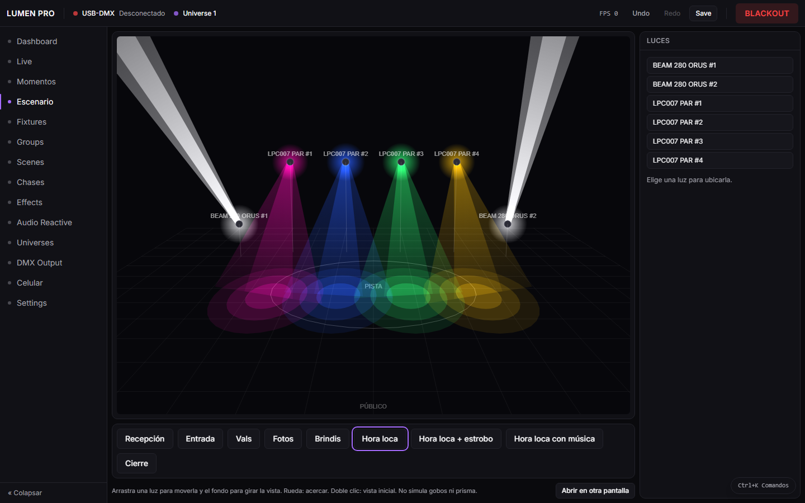
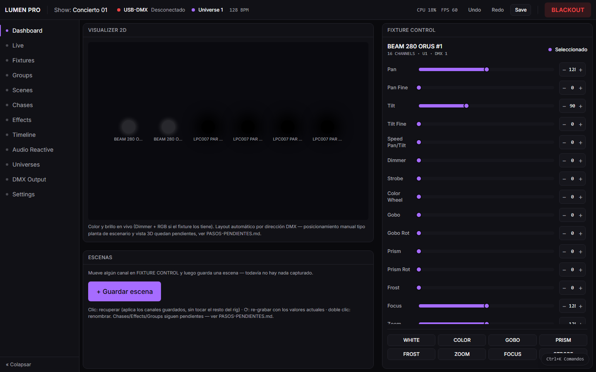

# LUMEN PRO — Consola de iluminación DMX

[](https://github.com/FernandoJose25/LUMENPRO/actions/workflows/ci.yml)


Software de escritorio para controlar luces de escenario por **DMX512**: cabezas móviles, PARs y otros equipos. Es una alternativa propia a consolas como MA o Chamsys, pensada para el equipo real de mi empresa de eventos (2× cabezas móviles Beam 280 y 4× PAR LED).

> **English summary:** Desktop DMX512 lighting console. React + TypeScript UI (design system, resizable workspace, fixture control, scenes, groups, chases with crossfades, parametric effects, beat tracking from live audio, stage simulator) plus a Rust show engine that runs in its own supervised process, so the lights keep going if the window hangs or crashes (and the window is reopened automatically); the same engine is compiled to WASM for the browser and the test suite. Open DMX (FTDI) and Enttec DMX USB PRO drivers with automatic reconnection. Integration tests with Vitest + Testing Library and unit tests in Rust.





## Mi rol

Lo diseñé y desarrollé solo, a partir de un brief de producto propio de 37 secciones: design system, UI, modelo de datos, motor DMX en Rust e integración con Tauri. La auditoría de lo construido frente al brief está en [AUDIT.md](AUDIT.md).

## Qué hace

- **Design system propio:** Button, Panel, Fader, Tabs e indicadores de estado, con tokens de color y tipografía.
- **Workspace profesional:** sidebar, topbar con estado del DMX, paneles redimensionables, **Blackout** global, deshacer y rehacer (`Ctrl + Z` / `Ctrl + Y`) y paleta de comandos (`Ctrl/Cmd + K`).
- **Fixtures:** biblioteca de QLC+ (1781 equipos, 5234 modos, con sus gobos y colores), editor de canales y control dinámico. Los faders, colores y presets se generan según el perfil de cada equipo (pan/tilt, dimmer, color wheel, gobo, prisma, etc.). Las cabezas se apuntan con un pad de 16 bits, y el dimmer y los colores aceptan curvas.
- **Scenes:** guardan una foto de los valores en vivo y luego se recuperan, re-graban o renombran.
- **Groups:** agrupan fixtures para controlarlos por lote.
- **Chases:** secuencias de escenas con fade y hold, en bucle o una sola vez.
- **Momentos:** el evento en orden (Entrada, Vals, Fotos, Hora loca…). Cada uno junta escena, chase y effects en un botón, con "Siguiente", transición y avance automático opcional. Incluye una plantilla de quinceañera.
- **Control por celular:** página en la red local (QR + PIN) con Siguiente, momentos, intensidad, estrobo y Blackout.
- **Effects:** generadores paramétricos (seno, cuadrada…) aplicados sobre un grupo, con un único motor de intervalos global.
- **Audio Reactive:** escucha la música por el micrófono o la entrada de línea, detecta los BPM y los golpes (autocorrelación y reloj predictivo propios) y los effects siguen el ritmo, los graves, los medios o los agudos. Sin música vuelven a su velocidad.
- **Simulador del escenario:** haces en perspectiva con pan/tilt, color, zoom, gobo, prisma y estrobo reales, posiciones editables y cámara libre. Sin dependencias 3D: proyección propia sobre canvas. Se puede abrir en un segundo monitor.
- **Equipos sin manual:** identificador que barre canal por canal y guarda su función, valor inicial y presets.
- **Motor del show independiente** (`show-engine/` y `src-tauri/src/engine/`): momentos, chases, effects y fades corren en Rust, en un proceso aparte con su guardián. Si la ventana se traba o se cae, las luces y el celular siguen y la ventana se reabre sola. El mismo motor, en WASM, mueve la versión de navegador y los tests.
- **Salida DMX en Rust** (`dmx-engine/`):
  - universo de 512 canales thread-safe;
  - hilo de salida a FPS fijo;
  - drivers para **cable FTDI (Open DMX)** y **Enttec DMX USB PRO** por puerto serie;
  - reconexión automática si se suelta el cable;
  - driver Mock para desarrollar sin hardware.
- **App de escritorio con Tauri 2** (`src-tauri/`): la ventana habla con el proceso del motor y guarda el show en disco, con exportar e importar.

## Stack

| Capa | Tecnologías |
|---|---|
| UI | React 18, TypeScript estricto, Vite, Tailwind CSS, react-resizable-panels |
| Estado | Store propio con Context; el show se guarda en `show.json` (app) o `localStorage` (navegador) |
| Motor | Rust: crates `lumenpro_show` (nativo y WASM) y `lumenpro_dmx`, hilos, `serialport` |
| Escritorio | Tauri 2 |
| Calidad | Vitest + Testing Library + jsdom (214 tests contra el motor real en WASM), `cargo test` (86 tests), GitHub Actions |

## Estructura

```
src/components/   ui/ (design system) · layout/ · fixtures/ · scenes/ · groups/ · chases/ · effects/ · audio/ · moments/ · stage/ · dmx/ · remote/ · live/ · command-palette/
src/lib/          fixtureStore (lo programado + espejo del motor), engineLink, wasmEngine, dmxFrame, dmxOutput, audioInput, beatTracker, history, remoteControl, stage, stageMirror
src/types/        Modelo de datos: fixture, scene, group, chase, effect, moment
src/test/         Tests de integración
show-engine/      Motor del show en Rust (nativo y WASM)
dmx-engine/       Salida DMX en Rust
src-tauri/        App de escritorio Tauri 2: proceso del motor, show en disco, servidor del celular y segunda ventana
```

## Correr el proyecto

```bash
rustup target add wasm32-unknown-unknown   # una vez: el motor va en WASM
npm install
npm run dev          # UI en el navegador
npm test             # tests de integración
npm run build        # typecheck + build de producción

cd show-engine && cargo test          # motor del show
cd dmx-engine && cargo test           # salida DMX
cd src-tauri && cargo check           # app de escritorio
npm run tauri dev                     # app de escritorio con la UI
npm run tauri build                   # instalador .exe (src-tauri/target/release/bundle/nsis)
```

## Estado y siguiente paso

La app se empaqueta como `.exe` y el motor corre aparte de la ventana. El show se maneja desde la laptop o el celular. Falta probarlo con el adaptador y las luces reales. El detalle está en [PASOS-PENDIENTES.md](PASOS-PENDIENTES.md).

## Créditos

Los perfiles de equipos (`public/library`) y las imágenes de gobos (`public/gobos`) son de [QLC+](https://www.qlcplus.org) (Heikki Junnila, Massimo Callegari y colaboradores), bajo [licencia Apache 2.0](public/library/LICENSE.txt). Ver [NOTICE](public/library/NOTICE.txt).
